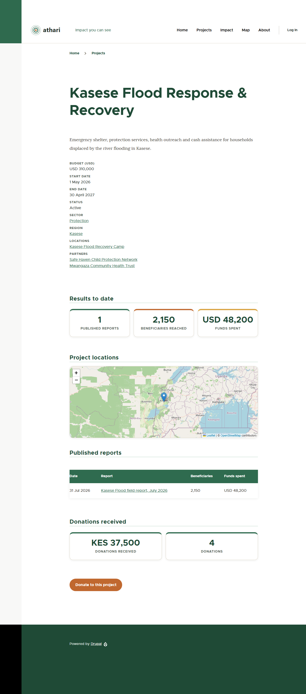
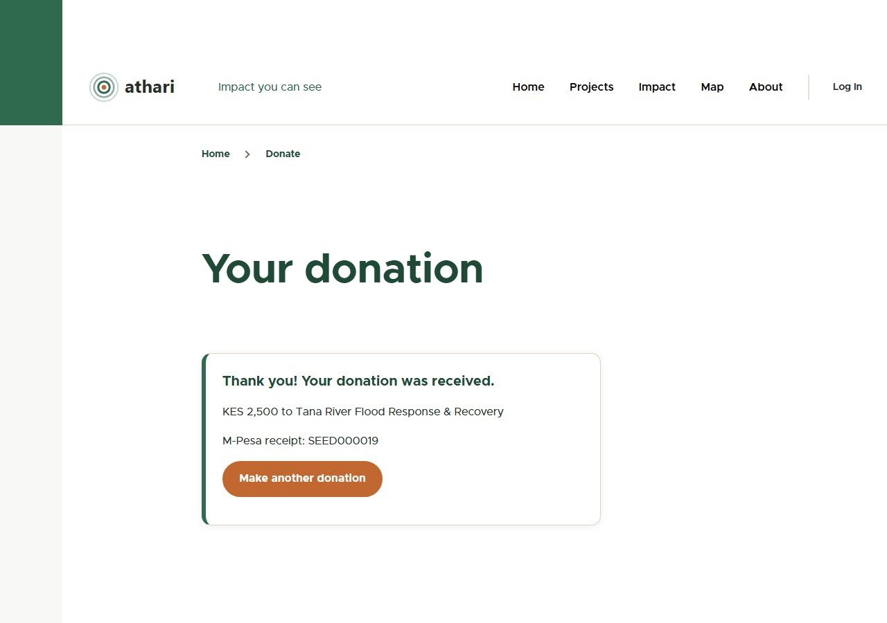
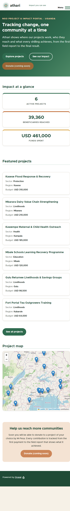

# Athari: NGO Project and Impact Portal

**Athari** (Swahili for "impact") is an open-source Drupal 11 portal that helps a Kenyan NGO manage its projects, collect field reports through a review workflow, show its impact on maps and charts, and accept donations by M-Pesa.

It was built as a five-day portfolio project, aimed at NGO IT and information-systems roles in Kenya. All amounts are in Kenyan shillings (KES) and the organisations, projects and people in the demo data are fictional.

| | |
|---|---|
| **Run it** | `ddev` quick-start below: clone, five commands, working portal with Kenya demo data |
| **Public API** | `/api` (read-only, see [docs/api.md](docs/api.md)) |
| **Deployment** | Deployment-ready, see [docs/deployment.md](docs/deployment.md) |
| **Source** | https://github.com/bmitigoa/athari |


## Quick start (run it locally)

You need [Docker Desktop](https://www.docker.com/products/docker-desktop/) and [DDEV](https://ddev.com/get-started/). Nothing else.

```bash
git clone https://github.com/bmitigoa/athari.git
cd athari
ddev start
ddev composer install
ddev drush site:install --existing-config -y --account-name=admin --account-pass=admin
ddev drush php:script scripts/kenya-01-regions.php   # 8 provinces and 47 counties
ddev drush php:script scripts/kenya-03-seed.php      # partners, projects, sites, reports, donations
ddev drush php:script scripts/day2-03-users.php      # demo staff accounts
ddev drush php:script scripts/day3-06-menu-about.php # main menu and About page
ddev drush cr
ddev launch
```

The site opens at `https://athari.ddev.site`.

### Demo logins (local only)

These passwords are deliberately simple. They exist only on your own computer.

| User | Password | Role | What to try |
|---|---|---|---|
| `admin` | `admin` | Site administrator | Everything, including *Configuration* |
| `ngoadmin` | `ngoadmin123` | Admin | Manage content, staff and donations |
| `fieldofficer` | `fieldofficer123` | Field Officer | *Content, Add content, Report*, then submit for review |
| `reviewer` | `reviewer123` | M&E Reviewer | Open the *Review queue*, approve or send back a report |

Log in at `/user/login`. Anonymous visitors see only published content.

### Optional: M-Pesa sandbox keys

Without keys, the donation form still loads and the seeded donations show how totals work. To send a real sandbox STK Push, copy `docs/daraja-settings.local.php.example` into `web/sites/default/settings.local.php`, fill in your own sandbox consumer key, secret and passkey from the [Safaricom developer portal](https://developer.safaricom.co.ke), and use a public HTTPS address for the callback (a tunnel works on a laptop). You can also simulate a callback with `scripts/day4-05-simulate-callback.php`.

## Demo

**Demo video:** DEMO_VIDEO_LINK_PLACEHOLDER

| Home | Projects |
|---|---|
|  |  |

| Impact dashboard | Project map |
|---|---|
|  |  |

| A project with its donations | Donate by M-Pesa |
|---|---|
|  |  |

| Donation status | Mobile view |
|---|---|
|  |  |

## Features

- **Projects, locations, partners.** Each project has a sector, a county, a budget in KES, dates, a status, partner organisations and project sites.
- **Kenya geography.** The 8 former provinces and 47 counties are loaded as a hierarchical vocabulary, so projects can be filtered by county or province.
- **Field reports with a review workflow.** Reports move through Draft, In Review, Published and Archived. Field officers write and submit, M&E reviewers approve or send back, and only published reports count towards public figures.
- **Impact dashboard.** Totals of beneficiaries reached and funds spent, plus charts by sector and by province, all calculated from published reports.
- **Project map.** Project sites on an OpenStreetMap map (Leaflet and Geofield).
- **M-Pesa donations.** A donation form sends an STK Push through Safaricom Daraja. The callback is stored in a custom Donation entity, with a status page for the donor and per-project totals.
- **Read-only public API.** JSON:API for projects, locations, partners, sectors, counties and published reports, plus a ready-made `/api/impact` summary. Donations, drafts and user data are never exposed.
- **Hardened production build.** HTTPS, security headers, private files, no development modules, scheduled cron and nightly backups.

## Architecture


In production everything runs on one small server in two containers: **MariaDB** and the **web app** (Drupal 11 on FrankenPHP, which is the Caddy web server with PHP built in). Caddy gets and renews the HTTPS certificate on its own and refuses requests for private files. Configuration lives in Git (`config/sync`) so the same site can be rebuilt anywhere.

How a donation flows:


## Data model


## Tech stack

| Layer | Choice |
|---|---|
| CMS | Drupal 11.4, PHP 8.3, Composer, Drush 13 |
| Database | MariaDB 11.8 |
| Web server | FrankenPHP (Caddy) with automatic HTTPS |
| Contrib modules | Admin Toolbar, Pathauto, Token, Geofield, Leaflet, Charts (Chart.js), Address, JSON:API Extras, Role Delegation, Config Split |
| Core features | Content Moderation, Workflows, Views, JSON:API, Language, Content Translation |
| Custom code | `athari_donate` (M-Pesa Daraja), `athari_api` (public API rules and impact summary), `athari_theme` (Olivero subtheme) |
| Local development | DDEV (Docker) |
| Quality checks | PHPUnit (unit and kernel), PHPCS with Drupal standards, verification scripts |

## Public API

Read-only and anonymous. A few examples (full list with sample responses in [docs/api.md](docs/api.md)):

```bash
# All projects, with their sector, county and locations
curl -H "Accept: application/vnd.api+json" "https://YOUR-SITE/api/projects?include=sector,county,locations"

# Only WASH projects
curl "https://YOUR-SITE/api/projects?filter[sector.name]=WASH"

# Published reports of one project, newest first
curl "https://YOUR-SITE/api/reports?filter[project.id]=PROJECT_UUID&sort=-report_date"

# Impact totals, ready for a dashboard
curl "https://YOUR-SITE/api/impact"
```

## Testing

```bash
# Unit and kernel tests of the custom modules (kernel tests need the database address)
ddev exec "SIMPLETEST_DB=mysql://db:db@db/db vendor/bin/phpunit -c web/core web/modules/custom"

# Coding standards
ddev exec vendor/bin/phpcs --standard=Drupal,DrupalPractice --extensions=php,module,inc,install,yml web/modules/custom

# Anonymous API checks (37) against local or live site
powershell -File scripts/day5-02-verify-api.ps1 -Base https://athari.ddev.site

# Configuration and permissions checks, and HTTP security probe
ddev drush php:script scripts/day5-04-security-check.php
powershell -File scripts/day5-05-security-http.ps1 -Base https://athari.ddev.site
```

Results of the checks that were run for the release are saved in `docs/reports/`.

## Deployment

Athari is **deployment-ready** but is not hosted publicly. The repository includes a production Docker image (Drupal 11 on FrankenPHP/Caddy with automatic HTTPS and MariaDB), a one-command server installer, nightly backups and an update script, tested on a local Docker stack. Step-by-step instructions for Oracle Cloud Always Free (Ampere A1) and any Ubuntu VPS are in [docs/deployment.md](docs/deployment.md).

## Payments

**M-Pesa runs against the Daraja sandbox; production requires merchant onboarding with Safaricom.** The sandbox never approves a payment on its own, so successful payments in the demo are shown with seeded data and a simulated callback.

## Documentation

- [Public API](docs/api.md)
- [Deployment guide](docs/deployment.md)
- Daily build reports in [docs/reports](docs/reports), and the final summary [docs/reports/final-summary.pdf](docs/reports/final-summary.pdf)

## Roadmap

- Airtel Money Kenya as a second mobile-money provider behind the same payment interface
- Card payments
- Two-factor login for staff accounts
- Self-hosted chart library (no CDN)
- Swahili translations of the public pages

## Author

Baraka Mitigoa. Built in Nairobi, Kenya.
