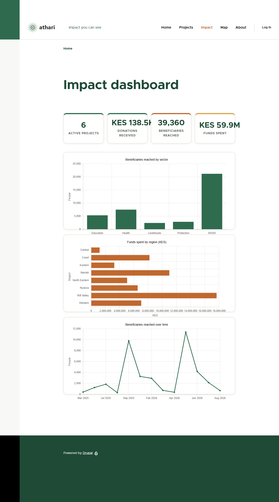
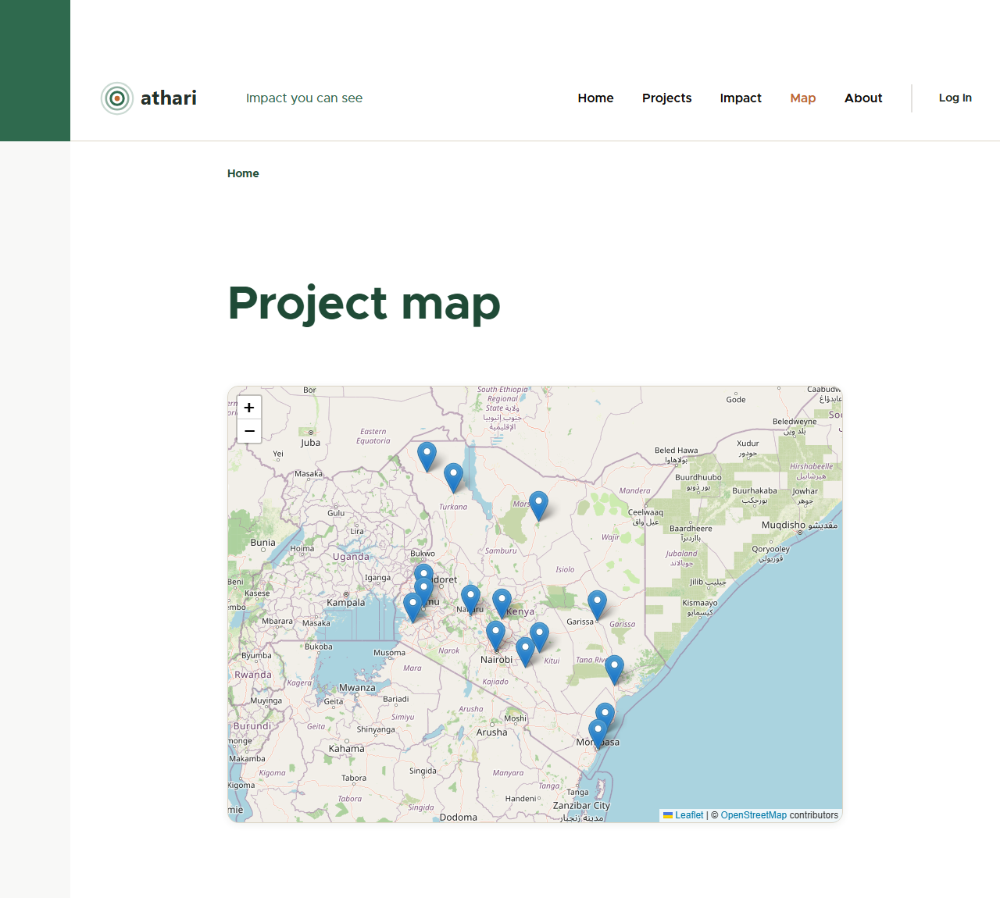
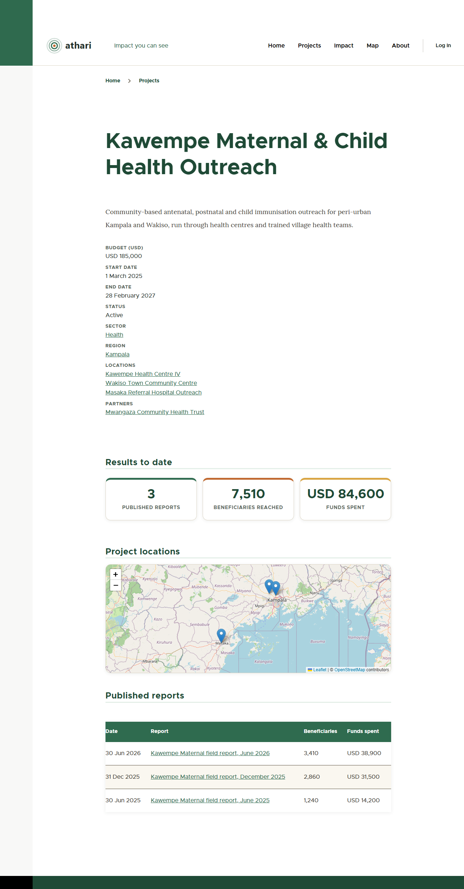

# Athari — Day 3 Report: Dashboard, Map & Theme

**Owner:** Baraka Mitigoa  **Project:** Athari (NGO Project & Impact Portal)  **Date:** 16 October 2026
**Local site:** https://athari.ddev.site  **Repository:** https://github.com/bmitigoa/athari

---

## 1. Summary

Day 3 turned the data model and sample data into something a visitor can actually use and look at.

- A custom theme, **Athari** (`athari_theme`), is now the site's default: a green and earth-tone look, an SVG wordmark, a responsive layout and a mobile menu.
- Five public pages exist: **Home**, **Projects** (cards or table, with filters), **Impact dashboard** (stat cards and three charts), **Project map** and **About**.
- Every project page now shows the project's results to date, a small map of its locations, and its published reports.
- A **Review queue** at `/review-queue` lists reports waiting for approval and is open only to M&E Reviewers and Admins.
- All dashboard numbers come from **published reports only**. I cross-checked them against the database: 39,360 beneficiaries, USD 461,000 spent, 6 active projects. The total for all reports, including drafts, is 58,285, which is deliberately *not* shown.
- 56 page-access checks (4 roles × 13 pages, plus a menu check per role) all pass, and the earlier 83 permission checks from Day 2 still pass.

Everything is exported to `config/sync`, so the views, blocks and theme settings travel with the Git repository.


---

## 2. Everything created or changed

### 2.1 Theme `athari_theme`

Location: `web/themes/custom/athari_theme/`

| File | What it is | Why |
|---|---|---|
| `athari_theme.info.yml` | Declares the theme: `base theme: olivero`, the regions, and the library to load. | Tells Drupal this is a sub-theme of Olivero and attaches our CSS to every page. |
| `athari_theme.libraries.yml` | Defines the `global-styling` library: `css/athari.css`, depending on `olivero/global-styling`. | Loads our CSS after Olivero's. The `version` number is bumped when the CSS changes so browsers fetch the new file. |
| `css/athari.css` | About 500 lines of CSS in 13 numbered sections: palette, base, header, buttons, hero, stat cards, cards, filters/tables, maps, project page, charts, footer, small screens. | The whole visual identity. |
| `logo.svg` | Wordmark: three concentric green "ripples" with an earth-coloured centre and the word *athari*. | The site logo (impact spreading outwards). |
| `favicon.svg` | Green rounded square with ripples. | Browser tab icon. |

**Why a sub-theme of Olivero rather than a Starterkit theme** (the choice you asked me to explain):

| | Sub-theme of Olivero | Starterkit (`generate-theme`) |
|---|---|---|
| Amount of code | Small: one CSS file | Large: a full copy of the base theme to maintain |
| Responsive layout, sticky header, mobile menu, accessible forms | Inherited free | Must be written or copied |
| Risk | Olivero is marked `@internal` and may change in minor Drupal releases | None from upstream; you own every file |
| Matches CLAUDE.md | Yes ("subtheme `athari_theme` based on Olivero") | No |

I chose the sub-theme because this is a five-day project and the hard parts (responsive navigation, accessible markup) are already solved. The risk is managed three ways: Drupal core is pinned by `composer.lock`; the theme uses Olivero's own CSS custom properties rather than overriding its internals; and there are no template overrides to break. If the project grows into a long-lived product, converting to a Starterkit theme is a one-off job that I would recommend at that point.

**Theme structure and how colour works.**

- *Regions* (areas of the page where blocks go) are inherited from Olivero: header, primary menu, secondary menu, hero (full width), highlighted, breadcrumb, social, content above, content, sidebar, content below, footer top, footer bottom.
- *Palette.* Olivero builds all its colours from a base colour. Olivero reads that from a theme setting, `base_primary_color`, and writes inline CSS variables on every page. Our CSS alone could not win against that inline style, so the setting itself is set to Athari green (`#2f6b4f`) in `athari_theme.settings.yml`. The other colours live as variables in `athari.css`: `--athari-green`, `--athari-earth` (terracotta), `--athari-sand` (page background), `--athari-ink` (text).
- *Branding block background* is set to white (`site_branding_bg_color: white`) so the dark logo is readable.
- *Libraries.* One library (`global-styling`) holds the one stylesheet.
- *Twig templates.* None are overridden. All markup changes use CSS classes assigned inside the Views (for example `athari-card`, `athari-stat`), which keeps the theme upgrade-friendly. A `templates/` folder can be added to the theme when overrides are needed.

**Block placement for the theme** (`block.block.athari_theme_*`): `scripts/day3-01-theme.php` copies every Olivero block placement (branding, main menu, page title, messages, tabs, footer credit and so on) to the new theme, because a newly installed theme starts with no blocks.

### 2.2 Views (all built as configuration and exported)

Views are built by scripts in `scripts/` and exported to `config/sync/views.view.*.yml`.

| View | URL | What it shows |
|---|---|---|
| `projects` | `/projects`, `/projects/table` | Project listing as cards or as a table. |
| `impact_totals` | `/impact` (+ a block on the home page) | Stat cards plus the three charts. |
| `impact_active_projects` | (embedded) | Count of active projects. |
| `impact_chart_sector` | (embedded) | Beneficiaries by sector (column chart). |
| `impact_chart_region` | (embedded) | Funds spent by region (bar chart). |
| `impact_chart_time` | (embedded) | Beneficiaries over time (line chart). |
| `project_map` | `/map` (+ a block on the home page) | Leaflet map of all project locations. |
| `review_queue` | `/review-queue` | Reports in the In Review state. |
| `project_totals`, `project_locations_map`, `project_reports` | Blocks on project pages | Per-project results, map and report list. |
| `home_hero`, `home_cta` | Blocks on the home page | Hero text and donation call to action. |
| `home_featured` | `/home` (the front page) | The six largest active projects. |

### 2.3 Other configuration and content

| Item | What it is | Why |
|---|---|---|
| Module `leaflet_views` | Leaflet's Views integration (a sub-module of Leaflet). | Provides the "Leaflet map" Views style. |
| `charts.settings` | Chart.js set as the default library, with the Athari palette. | Charts match the brand. |
| `system.site` | Name *Athari*, slogan *Impact you can see*, front page `/home`. | Branding and homepage. |
| Content type **Basic page** (`page`) | A simple page type with a Body field. | The Standard install in this project does not provide one; needed for the About page. |
| **About** page (`/about`) | Node with an explanation of the portal and an honest "sample data" note. | The About menu item. |
| Main menu | Home, Projects, Impact, Map, About, Review queue. | Navigation. "Review queue" is only *visible* to users who may open it, because Drupal hides menu links to routes the user cannot access. |
| Project node display | Dates shown as `1 March 2025` and budget without cents. | Tidy output. |
| `docs/screenshots/*.png` | Seven screenshots (desktop pages plus a 500 px wide homepage). | For the README. |
| `docs/reports/day-3-verification.txt` | Raw output of the page checks. | Evidence. |

Menu links and the About page are *content*, not configuration, so they are created by `scripts/day3-06-menu-about.php` rather than exported to Git.

---

## 3. Modules installed

| Module | Source | Purpose | Use in Athari |
|---|---|---|---|
| Leaflet Views (`leaflet_views`) | Contrib (part of Leaflet) | Views style plugin for Leaflet maps. | `/map`, the home-page map and the project-page map. |

Already installed on Day 1 and now used for the first time: **Leaflet** and **Geofield** (maps), **Charts** with **Chart.js** (charts), **Views** (all listings and totals), **Pathauto** (URLs of the new pages' content), **Content Moderation** (the review queue reads moderation state).

---

## 4. How each View is built

*Vocabulary:* a **relationship** joins another entity into the query (like a SQL JOIN). An **aggregation** (Views setting "Use aggregation") turns the query into a `GROUP BY` so fields can be summed or counted. A **filter** limits rows. A **contextual filter** (argument) takes its value from the page URL. **Exposed** means shown to the visitor as a form control.

### 4.1 Projects listing (`/projects`, `/projects/table`)

- **Base:** content (node). **Filters (fixed):** Published = yes, Content type = Project.
- **Exposed filters:**
  - *Sector*: a dropdown from the `field_sector` taxonomy term reference.
  - *Region / district*: a dropdown of the Region vocabulary using Drupal's "include children" depth filter. Choosing **Northern** shows projects in Gulu, Lira and Arua; choosing **Gulu** shows only Gulu.
  - *Status*: Planned, Active or Completed.
- **Sort:** start date, newest first.
- **Cards display (`page_1`):** fields Title (linked), Status, Sector, Region, Budget; style *Unformatted list* with each row given the class `athari-card`; 12 per page with a pager.
- **Table display (`page_2`):** overrides the style to *Table* with columns Project, Sector, Region, Status, Budget, Start, End, all sortable. On narrow screens Olivero's responsive-priority classes hide Sector and Region below 700 px and the dates below 1000 px, and a "Show all columns" link appears.
- **Cards ⇄ Table toggle:** a small text area in the header holds two links styled as buttons; the current one is highlighted.
- **Why it works this way:** one View with two displays shares the filters and data, so there is nothing to keep in sync.

### 4.2 Impact dashboard (`/impact`)

- **Stat cards (`impact_totals`).** Base: content. Filters: Published = yes, Type = Report. **Aggregation on.** Fields: *Beneficiaries reached* with aggregation type **Sum**, and *Funds spent* with **Sum**. Because both are summed and there is no grouping field, the query returns one row. The sums are reformatted with a Twig rewrite (`{{ field|number_format }}`) so that `39360` shows as `39,360`; the number formatter alone broke on aggregated values, which is recorded in the issues table.
- **Active projects (`impact_active_projects`).** Base: content. Filters: Published, Type = Project, Status = Active. Field *Content ID* with aggregation **Count**. It is embedded in the header of `impact_totals` using the "View" area plugin, so the three cards appear as one row.
- **Beneficiaries by sector (`impact_chart_sector`).** Filters: published reports. **Relationships:** Report → *Project* (via `field_project`), then Project → *Sector term* (via `field_sector`). Fields: term *Name* (grouped) and *Beneficiaries* (Sum). Sorted by name. Style: **Chart**, library Chart.js, type *column*.
- **Funds spent by region (`impact_chart_region`).** Relationships: Report → Project → *District term* (`field_region`) → *Parent term*. Fields: parent term *Name* (grouped), *Funds spent* (Sum). Style Chart, type *bar* (horizontal). **Limitation:** the projects are tagged with districts; the chart rolls them up to the parent region. A project tagged directly with a top-level region (not a district) would be left out of this chart.
- **Reports over time (`impact_chart_time`).** No relationships. Fields: *Report date* (formatted `M Y`, grouped) and *Beneficiaries* (Sum). Sorted by report date ascending. Style Chart, type *line*. Reports with the same date are added together.
- **The page.** `impact_totals` page display at `/impact`; its **footer** embeds the three chart views, its **header** embeds the active-project count.



### 4.3 Project map (`/map`)

- **Base:** content, filtered to published projects. **Relationship:** Project → *Locations* (`field_locations`, required). Because a project can have several locations, each project–location pair becomes one row, which is one map marker.
- **Fields (all excluded from display; they feed the map):** project *Title* (linked), location *Title* (through the relationship), location *Coordinates* (Geofield, through the relationship), and a *Custom text* field `popup` with the rewrite `<strong>{{ title_1 }}</strong><br>Project: {{ title }}`.
- **Style:** *Leaflet map*. Data source = the coordinates field, entity source = the locations relationship, popup = the `popup` field, height 560 px. The view is fixed on Uganda (centre 1.37 N, 32.29 E, zoom 7), so all 15 markers show.
- **Displays:** a page at `/map`, and a block (420 px) used on the home page.



### 4.4 Review queue (`/review-queue`)

- Cloned in code from core's own "Moderated content" view (so it inherits the correct, complicated query), then narrowed:
  - **Base:** content revisions. **Filters:** type = Report; moderation state = *Report review → In Review*; "latest translation affected revision" (core's way of picking the newest version of each item).
  - **Fields:** title, content type, author, moderation state, last updated and the operations dropdown.
  - **Access:** by **role**: M&E Reviewer, Admin and Administrator. Everyone else gets *Access denied*.
- It currently lists the **5** reports in the In Review state.

### 4.5 Project page blocks

These are **Views blocks** placed in the theme's *Content* region and shown **only on Project pages** (block visibility by content type). Each takes the project from the URL through a **contextual filter** set to "Content ID from URL".

| Block view | Base | Contextual filter | Output |
|---|---|---|---|
| `project_totals` | Reports, aggregated | Report's project = current project | Published reports (Count), beneficiaries (Sum), funds spent (Sum). |
| `project_locations_map` | Projects with locations relationship | Content ID = current project | Small Leaflet map (300 px) that fits its markers. |
| `project_reports` | Reports | Report's project = current project | Table of published reports, newest first, with an "empty" message. |

Partners already appear on the page as links from the project's own fields.



### 4.6 Homepage

The home page at `/` (front page set to `/home`) is built from blocks, all driven by config:

| Part | How |
|---|---|
| **Hero** (full-width band, tagline, buttons) | `home_hero`: a view with no result rows whose *header text area* contains the HTML and is set to display "even if the view has no results". Placed in the theme's *Hero* region on the front page. |
| **Impact stat cards** | `impact_totals` block in *Content above*. |
| **Featured projects** | `home_featured` page at `/home`: active projects sorted by budget, six cards, plus a "See all projects" button. |
| **Map** | `project_map` block in *Content below*, titled "Where we work". |
| **Donation call to action** | `home_cta`, same technique as the hero. The Donate button is a **placeholder** (disabled, labelled "coming soon") until Day 4. |
| **No duplicate heading** | The page-title block is hidden on the front page, so the hero's heading is the only H1. |

---

## 5. Code walkthrough

There is no module code today. The "code" is the scripts that build configuration, plus CSS.

| Script | Purpose |
|---|---|
| `scripts/lib-views.php` | Shared helper functions that return Views configuration arrays: `athari_vf()` (a field handler), `athari_vrel()` (a relationship), `athari_vfilters_node()` (published + bundle filters), `athari_varea_text()` / `athari_varea_view()` (text and embedded-view areas), `athari_vchart()` (a Chart.js style), `athari_vleaflet()` and `athari_vmap_fields()` (map style and fields), `athari_stat()` and `athari_rewrite()` (stat-card wrapper and number formatting). |
| `day3-01-theme.php` | Installs the theme (`theme_installer` service), sets it as default, sets logo, favicon, colour and branding settings, and clones the Olivero block placements. |
| `day3-02-view-projects.php` | Builds the projects view with `View::create()`. |
| `day3-03-views-impact.php` | Builds the five impact views. Charts are created first because the page that embeds them checks they exist. |
| `day3-04-views-map-review.php` | Builds the map view and clones/narrows the review queue. |
| `day3-05-views-home-project.php` | Builds the project-page, hero, call-to-action and featured views, then creates the block placements with `Block::create()`. |
| `day3-06-menu-about.php` | Creates the Basic page type, the About page and the menu links (content, so not in config). |
| `day3-07-project-display.php` | Updates the Project node display formats. |
| `day3-08-verify-pages.php` | Verification (see section 6). |
| `day3-09-repair-seed-revisions.php` | One-off data repair described in section 9. |

**Data flow of a dashboard number:** a visitor requests `/impact` → Drupal's router finds the `impact_totals` page display → Views builds one SQL `SELECT SUM(...)` over published report nodes → the Twig rewrite formats it → the theme's CSS turns each field wrapper into a card. The charts use the same pattern: Views groups the rows, then the *Chart* style plugin converts the rows into JSON for Chart.js, which draws on a `<canvas>` in the browser.

**Why scripts instead of clicking in the admin UI?** They are repeatable, reviewable in Git, and quick to rebuild. The *configuration they produce* (the exported YAML) is the source of truth; anyone can still edit a view in the UI afterwards.

---

## 6. How to use / test it

### Pages to open (all work for anonymous visitors unless noted)

| Page | URL |
|---|---|
| Home | https://athari.ddev.site/ |
| Projects (cards) | https://athari.ddev.site/projects |
| Projects (table) | https://athari.ddev.site/projects/table |
| Filter example | https://athari.ddev.site/projects?sector=1 (Health) |
| Impact dashboard | https://athari.ddev.site/impact |
| Project map | https://athari.ddev.site/map |
| A project page | https://athari.ddev.site/projects/kawempe-maternal-child-health-outreach |
| About | https://athari.ddev.site/about |
| Review queue (reviewer or admin) | https://athari.ddev.site/review-queue |

### Try it

1. Open the home page and scroll: hero, stat cards, featured projects, map, call to action.
2. Open **Projects**, choose *Sector = WASH* and click **Filter**. Switch to **Table** and click a column heading to sort.
3. Open **Impact**. Hover a bar or point to see its value.
4. Open **Map** and click a marker: the popup names the site and links to the project.
5. Open any project: see results to date, the map and the reports table.
6. Log in as `reviewer` (password in the Day 2 report), open **Review queue**, and approve a report. It leaves the queue, becomes visible publicly, and the dashboard totals rise.
7. Shrink the browser to phone width, or open the site on a phone, to see the mobile layout and the hamburger menu.

### Verification results

I rendered each page as each user by switching the current account and sending a real request through Drupal's HTTP kernel, so routing, access, Views, blocks and the theme all ran. Full output: `docs/reports/day-3-verification.txt`.

| Page | Anonymous | Field Officer | M&E Reviewer | Admin |
|---|:-:|:-:|:-:|:-:|
| `/`, `/home`, `/projects`, `/projects/table`, filtered projects, `/impact`, `/map`, `/about`, a project page | 200 | 200 | 200 | 200 |
| `/review-queue` | **403** | **403** | 200 (5 rows) | 200 (5 rows) |
| `/node/add/report` | 403 | 200 | 403 | 200 |
| `/node/add/project` | 403 | 403 | 403 | 200 |
| `/admin/content` | 403 | 200 | 200 | 200 |
| "Review queue" link in main menu | hidden | hidden | **shown** | **shown** |

All **56** checks passed, and the Day 2 permission script (83 checks) still passes.

**Numbers check:** published beneficiaries by SQL = 39,360, published funds = 461,000.00, active projects = 6, identical to the dashboard. Totals for the Kawempe project (7,510 people, USD 84,600) match the sum of its three published reports.

**Mobile layout:** checked in a real 375 px viewport (the built-in browser emulating a phone) on Home, Projects, Impact, Map and a project page: no horizontal scrolling. On the Table page the extra columns are hidden on narrow screens and revealed by "Show all columns" (confirmed in Microsoft Edge at 600 px).

**Not verified by me:** I did not type the test passwords into the login form (see Day 2); the above was done in-process. Please log in once as each user and look at the pages by eye.

---

## 7. Commands run

| Command | What it does |
|---|---|
| `ddev drush php:script scripts/day3-0N-*.php` | Runs each build script with Drupal loaded. |
| `ddev drush en leaflet_views` | Enables the Leaflet Views module. |
| `ddev drush cr` | Clears caches (also rebuilds CSS aggregates). |
| `ddev drush cex -y` | Exports configuration to `config/sync`. |
| `ddev mutagen sync` | Forces the file sync from the container to Windows. Always run it, and wait a few seconds, before committing config. |
| `python -m pip install markdown`, Edge headless `--print-to-pdf` / `--screenshot` | Used to produce the PDF reports and screenshots. |
| `git add`, `git commit`, `git push` | Version control. |

---

## 8. Drupal concepts explained

- **Views:** Drupal's query builder. A view is stored as configuration (YAML) and can render as a page, a block, or an area inside another view.
- **Displays:** one view can have several displays (page, block) that share a base setup and override parts.
- **Relationships:** how a view reaches related content. Without a relationship you can only use fields of the base item.
- **Aggregation (`GROUP BY`):** replaces rows by groups. Each field gets an aggregation type (Group, Sum, Count). Sorting and grouping then happen on the group.
- **Contextual filters:** filter values supplied by the URL or page. "Content ID from URL" lets one block serve every project page.
- **Views areas:** header, footer and empty text. The *View* area embeds another view; that is how the dashboard is composed.
- **Blocks and regions:** a block is a unit of content; a region is a slot in the theme; a *block placement* connects the two, with visibility conditions such as "only on the front page" or "only on project pages".
- **Base theme and sub-theme:** a sub-theme inherits templates, CSS and regions from its base and overrides only what it changes.
- **Libraries:** named bundles of CSS and JavaScript that Drupal attaches and optimises. The aggregated CSS file is named from the library list, so a library `version` bump is needed to force browsers to reload changed CSS.
- **Chart.js via the Charts module:** the module's Views style turns result rows into chart data; the library draws in the browser.
- **Moderation state in queries:** each revision carries a moderation state; the review queue filters revisions by that state.
- **Content versus configuration:** the views, blocks and theme settings are configuration (in Git). Menu links, the About page and users are content (in the database only), so scripts recreate them.

---

## 9. Issues and fixes

| Issue | Cause | Fix |
|---|---|---|
| Theme colours stayed blue. | Olivero writes its colours inline from a theme setting, which beats our CSS. | Set `base_primary_color` to Athari green in the theme settings. |
| Theme CSS was not loading at all. | `athari_theme.libraries.yml` was saved with a hidden byte-order mark (BOM) by PowerShell, which broke the YAML. | Rewrote the file as plain UTF-8. |
| Logo invisible on a green header box. | Olivero paints the branding block with the primary colour. | `site_branding_bg_color: white`. |
| "The plugin does not exist" when creating a view. | The `leaflet_map` style belongs to the separate `leaflet_views` module. | Enabled `leaflet_views`. |
| Filter crash on creating the view. | Views picks the filter plugin from the field's Views data, not from the `plugin_id` in my config; for a taxonomy reference that is `taxonomy_index_tid`. | Used that plugin's options. |
| Page that embeds charts failed to save. | An embedded view must exist when the page view is saved. | Created the chart views first. |
| Relationship errors. | Relationships were passed as a list, but Views needs them keyed by id. | Keyed the array by id. |
| Totals showed as `39, 360`. | Views splits aggregated numeric values on the thousands comma and re-joins them with a separator. | Plain number from the formatter, then a Twig `number_format` rewrite. |
| `/about` returned a 500 error. | This install has no *Basic page* content type; I had created a page node for a bundle that did not exist. | Deleted that one invalid node I had just created, created the Basic page type with a Body field, then the About page. |
| **Review queue empty although 5 reports were In Review.** | The Day 2 seed script saved state-only revisions without marking them "translation affected", so core's "latest revision" filter skipped them. | Fixed the seed script to set the flag, and repaired the existing 29 revisions with `day3-09-repair-seed-revisions.php` (it changes no content). |
| A bad commit deleted about 230 config files. | I committed while Mutagen was still syncing the files `drush cex` had just rewritten, so Git saw them missing. | Caught it from the commit's file count, undid that local commit before pushing, and re-committed after a full sync. Rule from now on: sync, wait, and check for deletions before committing config. |
| Stat cards laid out wrongly on the dashboard. | The card grid also wrapped the charts embedded in the same view. | Charts in the footer span all columns; three explicit columns. |
| Table too wide on phones. | Seven columns. | Responsive priorities hide three columns. The built-in preview browser used an engine too old for the CSS nesting that Olivero uses, so I confirmed this in Microsoft Edge. |
| My CSS edits seemed to have no effect. | Drupal names the aggregated CSS file from the library list, not its contents, so browsers cached it. | Bumped the library `version` after CSS changes. |
| Headless screenshots at 390 px looked clipped. | Edge's headless mode will not go narrower than about 500 px. | Checked phone width in the built-in browser's emulation, and saved a 500 px screenshot. |

---

## 10. Git log (Day 3)

```
6955715 docs: add Day 3 screenshots
604a6ee fix: responsive projects table, stat card grid and cache-busting theme library version
83f7d79 fix: project page formats, review queue seed revisions and per-role page verification
6d54b50 feat: add homepage, project page blocks, main menu, About page and Basic page type
c5bf9ff config: add impact dashboard, project map and review queue views
0209a75 config: add projects listing view with sector, region and status filters
afb21dc feat: add athari_theme (Olivero subtheme) with green/earth palette, logo and block placements
```

A final `docs: day 3 report` commit adds this report and its PDF.

---

## 11. Known limitations and next day

**Limitations**

- The Donate buttons are placeholders until Day 4.
- The "funds by region" chart omits any project tagged directly with a top-level region rather than a district.
- Impact figures are USD sums of sample data; they illustrate the design and are not real results.
- Menu links, the About page and the test users are not in Git; run the scripts in `scripts/` on a new install.
- Projects have no photos or partner logos yet.

**Day 4: Donations module (`athari_donate`)**

- Scaffold the custom module (info, routing, services, permissions files).
- Daraja settings form, with secrets read from `settings.local.php`.
- `DarajaClient` service: OAuth token with caching, plus STK Push.
- Donation form with phone-number validation (2547XXXXXXXX), and a callback route storing results in a custom **Donation** entity.
- Admin donations report and totals per project; turn the placeholder Donate buttons into real links; test against the Daraja sandbox.
