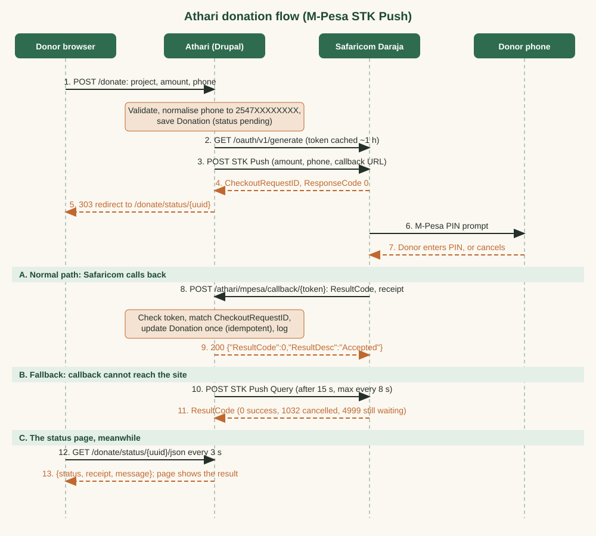

# Athari — Day 4 Report: Donations Module (`athari_donate`)

**Owner:** Baraka Mitigoa  **Project:** Athari (NGO Project & Impact Portal)  **Date:** 17 October 2026
**Local site:** https://athari.ddev.site  **Repository:** https://github.com/bmitigoa/athari

---

## 1. Summary

Day 4 added the ability to donate to a project by mobile money.

- A new custom module, **`athari_donate`**, talks to Safaricom's **Daraja** API. A donor chooses a project, an amount and a phone number; Athari asks Daraja to send an **M-Pesa STK Push** (a payment prompt) to that phone.
- Every attempt is stored as a **Donation** record (pending, success, failed or cancelled). The result arrives through a **callback** that Safaricom posts to a secret URL, and, if the callback cannot reach the site, through the **STK Push Query** that the status page uses as a fallback.
- Staff get a **donations report** at `/admin/content/donations`. Visitors see **donations received** on every project page and on the homepage, and the Donate buttons are now real.
- Credentials are read **only** from the git-ignored `settings.local.php`. I verified that none of them is in any committed file.
- The module was tested against the **real Daraja sandbox**: a token was issued, STK Push requests were accepted, a real callback arrived through a public tunnel, and the STK Query answered. That exercise found and fixed one real bug (section 10).
- **45 unit tests and 4 kernel tests pass**, the Drupal coding-standards check is clean, and 43 page and permission checks pass.

One honest limit: the sandbox has no phone that can approve a prompt, so it answers *cancelled* or *timed out*. The **success** path was verified by sending a callback in Safaricom's documented format through the same public URL.


---

## 2. Everything created or changed

### 2.1 The module `web/modules/custom/athari_donate/`

| File | What it is | Why |
|---|---|---|
| `athari_donate.info.yml` | Module declaration. Depends on node, options, user and views. | Lets Drupal install it. |
| `athari_donate.routing.yml` | Six routes (see 2.2). | Maps URLs to forms and controllers. |
| `athari_donate.services.yml` | Services: `athari_donate.daraja_client`, `athari_donate.donation_manager` and the `athari_donate` logger channel. | Dependency injection: classes get what they need handed to them. |
| `athari_donate.permissions.yml` | Four permissions (see 2.3). | Access control. |
| `athari_donate.links.menu.yml` | "Athari" section and "Donations (M-Pesa)" under Configuration. | Admin navigation. |
| `athari_donate.libraries.yml` | JavaScript library `status`. | Loads the polling script on the status page. |
| `athari_donate.install` | `hook_install` creates the callback token; `hook_uninstall` deletes it. | The token must exist from the first minute. |
| `athari_donate.module` | `hook_help` and `hook_cron`. | Cron marks donations that never got an answer as failed after 30 minutes. |
| `config/install/athari_donate.settings.yml` | Defaults: sandbox, empty credentials, limits KES 1 to 150,000. | Starting configuration. |
| `config/schema/athari_donate.schema.yml` | Describes the settings types. | Drupal validates and exports config with it. |
| `src/` | The classes (section 4). | |
| `js/donation-status.js` | Polls the status endpoint. | Live update without reloading. |
| `tests/` | Unit and kernel tests. | Section 6. |

### 2.2 Routes

| URL | Purpose | Who |
|---|---|---|
| `/donate` and `/donate/{project}` | Donation form (the second pre-selects a project) | Everyone |
| `/donate/status/{uuid}` | Status page shown after submitting | Everyone who has the (unguessable) address |
| `/donate/status/{uuid}/json` | Data the status page polls | Same |
| `POST /athari/mpesa/callback/{token}` | Where Safaricom posts the result | Anyone with the secret token |
| `/admin/config/athari/donate` | Settings form | Admin |
| `/admin/config/athari` | "Athari" settings section | Admin |
| `/admin/content/donations` | Donations report (a View) | Admin |

### 2.3 Permissions

| Permission | Granted to |
|---|---|
| `make donations` | Anonymous and authenticated users |
| `view athari donations` | Admin |
| `administer athari donate` | Admin |
| `administer athari donations` (raw entity access) | nobody by default (the Administrator super-user only) |

### 2.4 The Donation entity (`athari_donation`)

| Field | Type | Meaning |
|---|---|---|
| `id`, `uuid` | keys | Internal id; public, unguessable id used in status URLs |
| `project` | reference to a Project | Who receives the money |
| `amount` | decimal | Amount in KES |
| `phone` | text | Payer phone `2547XXXXXXXX` or `2541XXXXXXXX` |
| `status` | list | `pending`, `success`, `failed`, `cancelled` |
| `merchant_request_id`, `checkout_request_id` | text | Daraja's identifiers; the second is used to match the callback |
| `mpesa_receipt` | text | M-Pesa receipt number |
| `result_code`, `result_desc` | integer, text | Daraja's answer |
| `paid` | timestamp | When M-Pesa recorded the payment |
| `created`, `changed` | timestamps | |

The table has two indexes (added by `DonationStorageSchema`): one on `checkout_request_id` because every callback looks a donation up by it, and one on `(project, status)` because the reports total by those.

### 2.5 Views and other configuration

| Item | What it does |
|---|---|
| View `donations_admin` (`/admin/content/donations`) | Table of donations, newest first, 50 per page. **Filters:** status (dropdown), project name, M-Pesa receipt, date range. Phone numbers are **masked** (`25470****149`). Header shows the total and count (admin only). |
| View `donation_totals` | Aggregation (Sum of amount, Count) of **successful** donations. Three displays: a homepage card, a per-project block (uses the project in the URL as a contextual filter) and the admin header. |
| View `project_donate_button` | "Donate to this project" button on active project pages, linking to `/donate/{nid}`. |
| `impact_totals` (changed) | Now also embeds the donations card, so the homepage shows four stat cards. |
| `home_hero`, `home_cta` (changed) | The "coming soon" placeholders are now links to `/donate`. |
| Blocks | "Donations received" and the donate button are placed on Project pages. |
| Roles | Permissions in 2.3 granted. |
| Theme CSS | Styles for the status page; the stat-card grid now supports 4, 3, 2 or 1 columns. |

### 2.6 Scripts and docs

| File | Purpose |
|---|---|
| `scripts/day4-01-views-donations.php` | Builds the views, blocks and button updates. |
| `scripts/day4-02-permissions.php` | Grants permissions to roles. |
| `scripts/day4-03-verify-pages.php` | Page and permission checks (43). |
| `scripts/day4-04-seed-donations.php` | 19 fictional sample donations, receipts start `SEED`. |
| `scripts/day4-05-simulate-callback.php` | Sends Safaricom-format success, cancelled or failed callbacks for a donation, for demos. |
| `scripts/dev/callback_proxy.py` | A tiny proxy that exposes **only** the callback path to a tunnel. |
| `docs/daraja-settings.local.php.example` | What to put in `settings.local.php` (no real values). |
| `docs/diagrams/payment-sequence.svg` | The sequence diagram below. |

### 2.7 Development tooling

`composer require --dev drupal/core-dev` added PHPUnit, PHP_CodeSniffer and the Drupal coding standards (development only).

---

## 3. Modules installed

| Module | Purpose | Use in Athari |
|---|---|---|
| `athari_donate` (custom) | The donation feature. | Everything in this report. |
| `drupal/core-dev` (dev only) | PHPUnit, PHPCS, Drupal coder rules. | Tests and style checks. Not deployed. |

No other contributed modules were needed. Guzzle (the HTTP client Drupal already ships) makes the Daraja calls.

---

## 4. Payment flow and code walkthrough

### 4.1 Sequence diagram



### 4.2 Classes and methods

**`PhoneNumber`** (pure functions, no Drupal)
- `normalise($input)`: removes spaces, dashes, brackets and a leading `+`; turns `07…` and `01…` into `2547…` and `2541…`; adds `254` to nine-digit numbers; leaves anything else cleaned but unchanged.
- `isValid($number)`: true only for `254` + `7` or `1` + eight digits.
- `mask($number)`: keeps the first five and last three digits (used in the report).

**`PaymentProviderInterface`** (the seam for other providers)
- `getId()`, `isConfigured()`, `initiatePayment(phone, amount, reference, description, callbackUrl)`, `queryPayment(checkoutRequestId)`. `DarajaClient` is the only implementation today. An MTN MoMo or Airtel Money provider could implement the same four methods; the rest of the module does not mention M-Pesa by name.

**`DarajaException`**: carries a message that is safe to show a donor. Technical detail is logged, never shown.

**`DarajaClient`** (the only class that talks to the network)
- `getEnvironment()`, `getBaseUrl()`: sandbox or production URL, with an override used for testing against a mock.
- `getCredential($name)`, `isOverridden($name)`, `isConfigured()`: read credentials from config (that is, from the `settings.local.php` override); never from anywhere else.
- `getAccessToken($refresh)`: asks `/oauth/v1/generate` with HTTP Basic auth, **caches** the token (cache id includes the environment and a hash of the key) until two minutes before it expires, and refreshes on demand.
- `buildPassword()`: `base64(shortcode + passkey + timestamp)`, as Daraja requires. `buildTimestamp()`: `YYYYMMDDHHMMSS` in East Africa Time.
- `initiatePayment()`: builds the STK Push payload (shortcode, password, timestamp, amount, payer, callback URL, a 12-character reference), posts it, and checks that Daraja answered `ResponseCode 0`.
- `queryPayment()`: the STK Push Query. Maps Daraja's answer to `success` (0), `cancelled` (1032), `processing` (4999, or HTTP 500 "being processed", or no code) or `failed` (anything else).
- `postStkPush()`, `postQuery()`: do the HTTP call, and **retry once** with a fresh token if Daraja answers 401.
- `describe()`, `redact()`, `truncate()`: build log messages without headers or credentials.

**`Donation`** (content entity) and **`DonationInterface`**: the record described in 2.4, with status constants and small getters. `preSave()` strips non-digits from the phone. `baseFieldDefinitions()` defines the fields. **`DonationStorageSchema`** adds the two indexes.

**`DonationManager`** (the rules)
- `getCallbackSecret()`, `regenerateCallbackSecret()`: a 32-hex-character token from `random_bytes`, kept in **state** (so it is never exported to Git).
- `getCallbackUrl()`: the route plus the token, on the configured public base URL if there is one.
- `createPending()`: saves a pending donation.
- `initiate()`: calls the provider; on success stores Daraja's ids; on failure marks the donation failed and re-throws.
- `processCallback($payload)`: **the heart of the module.** Looks up the donation by `CheckoutRequestID`; ignores malformed or unknown payloads; if the donation is pending, sets success (receipt, payment time; notes a mismatch in the amount), cancelled (1032) or failed. It is **idempotent**: a repeat changes nothing. A success callback can *upgrade* a donation that a status query or timeout marked failed or cancelled (money received is the truth), and can add a receipt to a donation a query already marked success. A later failure can never undo a success.
- `refreshPending()`: STK Query fallback, used by the status endpoint. Waits 15 seconds, then asks at most every 8 seconds, never throws, and leaves the donation pending on any error.
- `expirePending()`: used by cron.
- `statusData()`, `statusMessage()`: donor-friendly text for each state.

**`SettingsForm`**: environment, shortcode, callback base URL and limits. Anything overridden in `settings.local.php` is shown **read-only**. The three credentials are shown only as "Configured (value hidden)" or "Not set", never saved by the form. It previews the callback URL with the token masked, warns when the address is local, can rotate the token, and has a **Test connection** button that requests a token and reports success or failure.

**`DonationForm`**: lists active, published projects; validates the amount (a whole number between the limits), the phone number and the project; limits a visitor to 5 attempts in 10 minutes with Drupal's flood service; saves a pending donation, starts the payment and redirects to the status page. A failure shows a donor-safe message and rebuilds the form.

**`StatusController`**: `page()` shows the result and attaches the script; `json()` calls `refreshPending()` and returns `{status, amount, receipt, message}` with no-store headers.

**`CallbackController::receive()`**: compares the path token with `hash_equals`, refuses bodies that are empty or over 64 KB, decodes JSON with a depth limit, calls `processCallback()`, and **always** answers `200 {"ResultCode":0,"ResultDesc":"Accepted"}`. Problems go to the log.

**`js/donation-status.js`**: every 3 seconds fetches the JSON, updates the message, receipt and style, and stops when the status is no longer pending (or after 5 minutes).

**`athari_donate_cron()`** calls `expirePending()`.

### 4.3 How Drupal connects it together

A route (`routing.yml`) names a form or controller class; Drupal builds it through `create()`, which pulls the services it needs from the container (`services.yml`); services get the HTTP client, config, cache, state and logger by constructor injection, so nothing calls `\Drupal::` inside the classes. The entity type is discovered from the `#[ContentEntityType]` attribute and its tables are created when the module is installed. Views reads the entity's field definitions (`EntityViewsData`) to offer fields, filters and relationships.

---

## 5. How to use and test a donation

1. Start the site (`ddev start`) and make sure `settings.local.php` has your three Daraja values.
2. Open https://athari.ddev.site/admin/config/athari/donate (as `ngoadmin`) and press **Test connection**. You should see "Connected to Daraja (sandbox). An access token was issued." (I ran the same token request from a script and it worked, but I did not click this button in a browser.)
3. Open any active project page and press **Donate to this project**, or go to https://athari.ddev.site/donate.
4. Enter an amount (for example `1`) and the sandbox number **0708374149** (also accepted as `+254708374149`). Press **Donate with M-Pesa**.
5. You land on the status page. It says "Check your phone…" and updates itself.
   - The sandbox has no real phone, so within about 15 to 60 seconds the result is **cancelled** or **failed (no response)**. That is Daraja's sandbox behaviour, and the record shows Daraja's own result code.
6. To see the **success** path, simulate Safaricom's callback for the latest pending donation:

```bash
ddev drush php:script scripts/day4-05-simulate-callback.php -- 0 success
```

   Replace `success` with `cancelled` or `failed` to try those. The status page switches to "Thank you! Your donation was received." and shows a receipt number.
7. Open https://athari.ddev.site/admin/content/donations (as `ngoadmin`) to see the record. The project page and the homepage totals include it.

**To receive Safaricom's real callback on a local machine** you need a public address:

```bash
python scripts/dev/callback_proxy.py callback.log 8765      # exposes only the callback path
cloudflared tunnel --url http://127.0.0.1:8765               # prints https://something.trycloudflare.com
```

Add `$config['athari_donate.settings']['callback_base_url'] = 'https://something.trycloudflare.com';` to `settings.local.php`, submit a donation and watch `callback.log`. Remove the line and rotate the token afterwards. On a public server none of this is needed.

---

## 6. Tests and verification

| Check | Result |
|---|---|
| Unit tests (`PhoneNumberTest`, `DarajaClientTest`, `DonationManagerCallbackTest`) | **45 tests, 129 assertions, all pass** |
| Kernel tests (real database) | **4 tests, 52 assertions, all pass** |
| Drupal and DrupalPractice coding standards | **clean** |
| Page and permission checks (`day4-03-verify-pages.php`) | **43 of 43 pass** |
| Donations report rendered as `ngoadmin` | 25 rows, filters work, phone numbers masked (`25470****149`), no raw numbers or secrets in the page |
| Earlier suites | Day 2: 83 of 83 pass. Day 3: 56 of 56 pass. |

**What the tests cover**

- *Phone numbers:* 12 accepted forms (07…, 01…, +254…, 254…, nine digits, spaces, dashes, brackets, whitespace) and 9 rejected ones (empty, letters, too short, too long, wrong country, landline style, Uganda number, a lone plus, an SQL-looking string).
- *Callback parsing:* success, cancelled (1032), failed, a different paid amount, malformed bodies, unknown `CheckoutRequestID`.
- *Idempotency:* the same callback three times saves once; a late failure cannot overwrite a success; a success callback upgrades a failed or timed-out donation; a callback after a status query adds the receipt exactly once.
- *Daraja client (no network, mocked):* token request shape and Basic auth, caching, forced refresh, base URLs, missing credentials, the STK Push payload field by field (including the password and the 12-character reference), a rejected push, token refresh on 401, and the STK Query mapping for 0, 1032, 1, 2001, 1037, 4999 and "being processed".
- *Kernel:* creating a donation, the callback endpoint with a wrong token (ignored, still 200), garbage (ignored), a good body (success) and a repeat (no change), token format and rotation, and cron timeout.

**Do the tests really catch mistakes?** I changed the cancel code from 1032 to 1033 and disabled the duplicate guard on purpose. Four tests failed. I restored the code and all eight passed again.

**Pages and permissions**

| Page | Anonymous | Field Officer | Reviewer | Admin |
|---|:-:|:-:|:-:|:-:|
| `/donate`, `/donate/{project}` | 200 | 200 | 200 | 200 |
| `/donate/status/{uuid}` and `/json` | 200 | 200 | 200 | 200 |
| Unknown status id | 404 | 404 | 404 | 404 |
| `/admin/content/donations` | 403 | 403 | 403 | **200** |
| `/admin/config/athari/donate` | 403 | 403 | 403 | **200** |
| `GET` on the callback URL | 405 | 405 | 405 | 405 |

The callback `POST` was also checked over real HTTP: a good token answers `200` with the Daraja JSON, a wrong token answers the same `200` and changes nothing.

**Real Daraja sandbox end to end** (credentials from `settings.local.php`, values never printed)

| Step | Result |
|---|---|
| OAuth token | Issued; the second call came from the cache |
| STK Push (KES 1 to 2, test number) | Accepted by Safaricom every time (about six attempts) |
| Public tunnel (path allow-list proxy) | Only the callback path was reachable: `/`, `/user/login`, `/admin` and `/donate` all answered 404 through it |
| **Real callback from Safaricom** | Arrived about 19 seconds later: `ResultCode 1032 "Request Cancelled by user."`; the donation became *cancelled* and the status page showed it |
| Real STK Query answers | `1037 "No response from user"`, and `4999 "The transaction is still under processing"` (this one exposed a bug, section 10) |
| Success path | A success callback in Safaricom's documented format sent **through the same public URL**: donation became *success* with receipt `TESTATHARI1`; a duplicate delivery changed nothing |
| After the test | Tunnel and proxy stopped, the temporary line removed from `settings.local.php`, and the callback token rotated |

---

## 7. Security measures

| Risk | What is done |
|---|---|
| Secrets in Git | Credentials live only in `settings.local.php` (git-ignored). Before committing I searched every staged file for the three real values: no match. The exported config holds empty strings. The sandbox passkey and keys are not written in any document. |
| Secrets on screen or in logs | The settings form never shows or saves them; logs record HTTP status and truncated bodies but never headers, tokens or passwords; `redact()` strips tokens from logged responses. |
| Forged callbacks | The callback URL contains a 32-hex-character token made with `random_bytes`, compared with `hash_equals` (no timing leak). A callback also has to match a `CheckoutRequestID` of a donation we created. A wrong token is answered like a right one, so an attacker learns nothing. |
| Replayed or duplicated callbacks | Idempotent processing: only a pending donation changes; a success is never overwritten. |
| Oversized or malformed bodies | Body limited to 64 KB, JSON depth limited to 8, shape checked. |
| Amount tampering | The phone and amount are validated server-side; the paid amount in a callback is compared with the requested amount and any difference is written on the record and logged. |
| Abuse of the donation form | Drupal's flood control: 5 attempts per 10 minutes per visitor; amount limits; the form is protected by Drupal's form token. |
| Input validation | Phone normalised then matched against a strict pattern; the amount must be digits only; the project must be an active, published project. |
| Personal data | Phone numbers are masked in the report and are not shown on the status page; the status page is reached only by an unguessable UUID and shows no phone number. |
| Error messages | Donors see friendly sentences; details go to the `athari_donate` log channel. |
| Over-exposure when testing | The public tunnel pointed at an allow-list proxy that forwards only `POST /athari/mpesa/callback/<token>`. Everything else returns 404, so the local site and its admin login were never exposed. The token was rotated afterwards. |
| Supply chain | The `cloudflared` binary was downloaded from the official GitHub release and its Authenticode signature was checked (valid, Cloudflare, Inc.) before use. |
| Safe defaults | Sandbox is the default environment; the callback base URL must be an https address. |
| Access control | Four permissions; the report and settings are Admin only; checked in section 6. |

**Not done (for production):** restrict the callback to Safaricom's published IP ranges; verify the donor-facing status page with a captcha if abuse appears; encrypt phone numbers at rest if the law or policy requires it.

---

## 8. Commands run

| Command | What it does |
|---|---|
| `ddev composer require --dev drupal/core-dev` | PHPUnit and coding-standards tools |
| `ddev drush en athari_donate` | Install the module (creates the entity tables and the callback token) |
| `ddev drush php:script scripts/day4-0N-*.php` | Run the build, seed and check scripts |
| `ddev drush cex -y` | Export configuration |
| `vendor/bin/phpunit -c web/core web/modules/custom/athari_donate/tests/src/Unit` | Unit tests |
| `SIMPLETEST_DB=mysql://db:db@db/db vendor/bin/phpunit … tests/src/Kernel` | Kernel tests (use the real database server, with test table prefixes) |
| `vendor/bin/phpcs --standard=Drupal,DrupalPractice web/modules/custom/athari_donate` | Coding standards |
| `python scripts/dev/callback_proxy.py …` and `cloudflared tunnel --url …` | Temporary public callback address |

---

## 9. Drupal concepts explained

- **Custom module and PSR-4:** code in `src/` is found by namespace (`Drupal\athari_donate\…`) with no manual includes.
- **Services and dependency injection:** a service is a reusable object defined in `services.yml`. Classes receive their dependencies in the constructor instead of reaching for globals, which makes them testable (the unit tests hand in fakes).
- **Content entity and base fields:** a custom record type with its own database table. Base fields are defined in code; `#[ContentEntityType]` registers the type.
- **Entity references:** `project` points at a Project node; Views turns it into a relationship.
- **Config overrides:** `$config['name']['key']` in `settings.local.php` replaces a configuration value at runtime without touching the stored or exported config. That is how secrets stay out of Git.
- **State:** a small key-value store in the database for machine-specific values (the callback token). Unlike config it is never exported.
- **Form API:** `buildForm`, `validateForm`, `submitForm`. Validation runs before submission; Drupal adds the CSRF token.
- **Flood control:** a service that counts events per visitor in a time window.
- **Routes and access:** `_permission`, or `_access: 'TRUE'` for a public route that protects itself (the callback).
- **Idempotency:** doing the same operation twice has the same result as doing it once. Essential for webhooks, which are delivered at least once.
- **Webhook and callback:** the other server calls *you* when something happens. It must be reachable from the internet.
- **OAuth client credentials:** exchange a key and secret for a short-lived token; cache it until it expires.
- **STK Push:** a payment prompt sent to the donor's phone. The donor approves it with a PIN; the merchant never sees the PIN.
- **Views aggregation:** the donation totals are `SUM` and `COUNT` queries, with the project taken from the page URL (a contextual filter).
- **Cron:** a regular background run used here to expire donations that never got an answer.

---

## 10. Issues and fixes

| Issue | Cause | Fix |
|---|---|---|
| **Work stopped part-way earlier in the day.** | You asked me to stop. | Resumed from your new, more detailed instructions; the partial module was adapted rather than discarded. |
| Docker and the site were down. | A new day, Docker Desktop was not running. | Started Docker Desktop and `ddev start`. |
| A control character corrupted a code comment. | A scripting escape (`\a`) in my edit. | Found it by a search and rewrote the line. |
| First sandbox donation refused with "must be higher than or equal to 10". | My default minimum was 10; your spec says 1. | Default changed to 1 in the install config and the live config. |
| **Real bug found by the sandbox:** a donation was marked *failed* too early. | The STK Query returned HTTP 200 with `ResultCode 4999 "still under processing"`, and my code treated every non-zero code as failure. | 4999 is now "still processing". A unit test using that exact answer was added. |
| Danger that the early failure could hide real money. | A later success callback would have been ignored because the donation was no longer pending. | A success callback now upgrades a failed or cancelled donation. Tested, and a late failure still cannot undo a success. |
| A donation callback test through the page-check script returned 405. | My test script reused one array key for GET and POST, so only one ran. | Removed the duplicate row. Real HTTP tests show the route behaves as designed. |
| The donations report showed **no rows** at first. | A "grouped" filter (the Status dropdown) must also be *exposed*; mine was not, so it filtered on an empty value. | Exposed it. The report now lists 25 rows; Status, project, receipt and date filters return 17 (success), 3 (cancelled), 5 (Kasese) and 1 (one receipt) rows when tried. |
| The settings form did not show overridden values as read-only. | `ConfigFormBase::config()` returns the *editable* config, which has no `settings.local.php` overrides. | Read the settings through the config factory instead. Seventeen fields are now read-only and the three credentials show "Configured (value hidden)". |
| **Re-running the views script deleted the homepage stat cards.** | `impact_totals` embeds `donation_totals`. In Drupal, deleting a view also deletes config that depends on it, so the cascade removed `impact_totals` and its block. I spotted it from two unexpected deletions in `git diff --cached`. | Rebuilt the Day 3 views, and changed the script to let go of the embed first. It was then run twice in a row to prove it is safe to repeat. |
| `winget install cloudflared` hung. | It waited for a Windows administrator prompt. | Stopped it and used the official portable binary after checking its digital signature. |
| `ddev` quoting problems for inline PHP. | PowerShell and bash both parse the quotes. | Put the logic in script files. |
| The sandbox never gives *success*. | It cannot simulate a phone approving. | Success verified with a simulated callback on the real HTTP route; documented in 6. |

---

## 11. Git log (Day 4)

```
9efc0c7 fix: grouped status filter, read-only overrides in settings form, safe re-run of donation views
02bc745 docs: add payment sequence diagram, settings example, callback simulator and tunnel proxy
e79d7e9 feat: donation status page styling, sample donations, donation page checks and screenshots
a278dd4 fix: treat STK Query 4999 as still processing, let a success callback upgrade a failed donation, minimum donation KES 1
c6ed7c2 config: add donation views, permissions, project donation blocks and live Donate buttons
3b11bcd feat: add athari_donate module with Daraja STK Push, donation entity, callback and status page
94ff7cd chore: add drupal/core-dev for PHPUnit and coding standards
```

The final `docs: day 4 report` commit adds the finished report and its PDF.

---

## 12. Incomplete, limits and next day

**Incomplete or limited**

- **MTN MoMo (optional)** is not built. The `PaymentProviderInterface` is defined and `DarajaClient` implements it, so MoMo is the next provider to add.
- **Currency and country:** Daraja is **Safaricom's Kenyan M-Pesa**. It takes Kenyan shillings and Safaricom numbers (`2547…` and `2541…`). Athari's projects are in Uganda, where donors would normally use MTN MoMo or Airtel Money. For a Uganda go-live, the MoMo or Airtel provider is the more relevant one, and amounts would be in UGX. The project budgets elsewhere are in USD; donation totals are shown in KES and are not converted.
- **Success in the sandbox** can only be simulated, as explained above. A real approval needs a production shortcode.
- The **real callback** was observed once (a cancel). Safaricom's behaviour for a *successful* real payment is as documented but unobserved here.
- **Production readiness** is pending merchant onboarding with Safaricom (a paybill or till, go-live approval, the production keys and a public HTTPS site).
- **No refunds, no receipts by email or SMS**, and no donor accounts (donations are anonymous).
- The sample donations (19) and the test donations are in the database only, not in Git. Their phone numbers are fictional.
- I did not log in through the browser form, so the admin screens (settings form and donations report) are verified by the in-process checks, not by screenshots. Please look at them once while logged in as `ngoadmin`.

**Day 5: API, deployment and polish**

- Enable JSON:API read-only for projects, locations and impact data; document example endpoints.
- Security pass (permissions review, input validation, logging), then deploy and record the live URL.
- Write the `README.md` with screenshots, architecture, data model, setup steps and the note "payments run against the Daraja sandbox; production-ready pending merchant onboarding".
- Final config export, tag `v1.0.0`, and the Day 5 report with the final project summary PDF.
