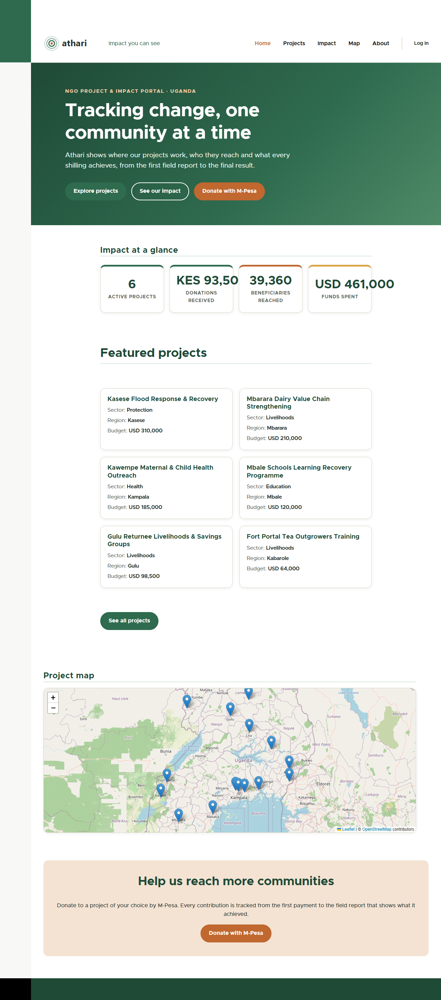
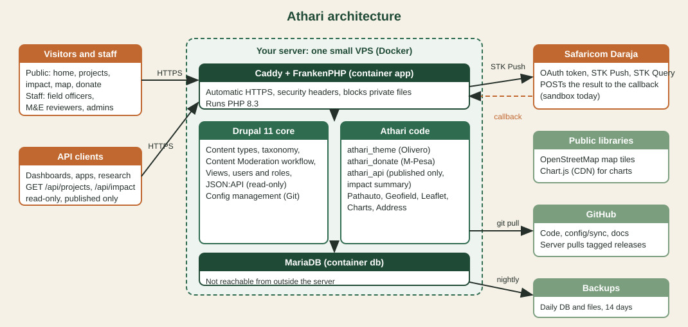
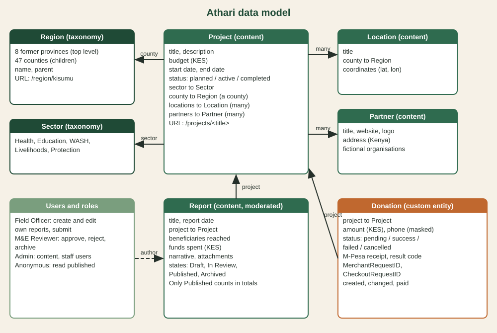
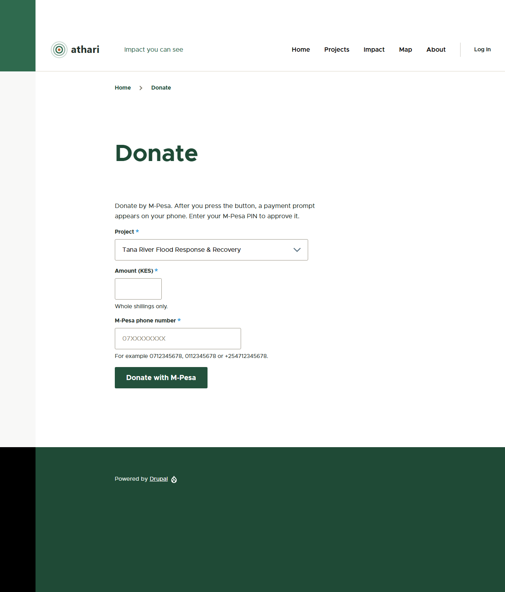

# Athari — Final Project Summary

**Owner:** Baraka Mitigoa  **Version:** `v1.0.0`  **Date:** 17 October 2026
**Repository:** https://github.com/bmitigoa/athari

---

## 1. What Athari is

**Athari** (Swahili for "impact") is a Drupal 11 portal for a Kenyan NGO. It lets the organisation:

1. keep a record of its **projects**, the **sites** where they run, and its **partners**;
2. collect **field reports** from staff in the counties, check them through a **review workflow** and publish only approved ones;
3. show its **impact** (people reached, shillings spent) as totals, charts and a map;
4. accept **donations by M-Pesa** to a chosen project;
5. share its data with other systems through a **read-only public API**.

All money is in **Kenyan shillings (KES)**. The geography is Kenya's 8 former provinces and 47 counties. The organisations, projects and people in the demo data are fictional.

It was built in five days as a portfolio project for NGO IT and information-systems roles in Kenya.



---

## 2. Architecture



| Layer | What | Notes |
|---|---|---|
| Content management | **Drupal 11.4** on PHP 8.3 | Content types, taxonomy, users, workflow, views, theming |
| Data | **MariaDB 11.8** | Not reachable from outside the server in production |
| Web server | **FrankenPHP (Caddy)** | Automatic HTTPS, security headers, blocks private files |
| Custom code | `athari_donate`, `athari_api`, `athari_theme` | The only code written for the project (everything else is configuration or standard modules) |
| Configuration | `config/sync` in Git | The whole site is rebuilt by `drush site:install --existing-config` |
| Environments | DDEV locally; Docker Compose bundle for servers | Development tools only in the `dev` configuration split |
| External | Safaricom **Daraja** (M-Pesa), OpenStreetMap tiles, Chart.js CDN | Daraja is sandbox only |

### How the pieces connect

- **Content model → everything else.** Projects, locations, partners and reports are *content types*. The views (listing, dashboard, map, review queue), the API and the donation pages all read these same records, so a report approved by a reviewer changes the dashboard, the API and the homepage figures at once.
- **Workflow → trust.** Only **Published** reports count in totals and in the API. A report is Draft, In Review, Published or Archived, and what a person may do depends on their role.
- **Configuration → repeatability.** Every content type, field, view, role, workflow and setting is exported to `config/sync`. A new machine or server gets the same site from Git, plus the Kenya sample data from scripts.
- **Donations → projects.** A donation is a custom *entity* that points at a project. Success updates the project's totals, which are shown on the project page and the homepage.
- **Secrets stay out of Git.** Daraja keys, the callback token and the database password live in `settings.local.php` (git-ignored, or generated on the server).

---

## 3. Data model



| Item | Type | Main fields |
|---|---|---|
| **Sector** | Taxonomy | Health, Education, WASH, Livelihoods, Protection |
| **Region** | Taxonomy (hierarchy) | 8 provinces (parents), 47 counties (children) |
| **Project** | Content type | title, description, budget (KES), start and end date, status (Planned, Active, Completed), sector, county, locations, partners |
| **Location** | Content type | title, county, coordinates (Geofield latitude and longitude) |
| **Partner** | Content type | title, logo, website, address |
| **Report** | Content type (moderated) | project, report date, beneficiaries reached, funds spent (KES), narrative, attachments |
| **Donation** | Custom entity | project, amount (KES), phone, status (pending, success, failed, cancelled), M-Pesa receipt, result code and text, request ids, timestamps |
| **Page** | Content type | The About page |

---

## 4. Every feature

### 4.1 Content and navigation (Day 1)
- The five content types and two vocabularies above, with entity references between them (a project points at a sector, a county, locations and partners; a report points at a project).
- **Pathauto** makes readable addresses such as `/projects/<title>` and `/region/<county>`.
- **Address** is used for partner addresses, **Geofield** for coordinates, **Admin Toolbar** for faster admin menus.

### 4.2 Roles and the review workflow (Day 2)
| Role | Can do |
|---|---|
| Anonymous | Read published content, view the dashboard, map and API, donate |
| **Field Officer** | Create reports, edit their own, submit them for review |
| **M&E Reviewer** | See the review queue, approve (publish), send back to draft, archive |
| **Admin** | Manage content, create Field Officers and Reviewers, see donations |
| **Administrator** | Technical owner: modules, configuration, permissions |

The workflow `report_review` has four states (Draft, In Review, Published, Archived) and transitions between them, enforced by **Content Moderation**.

### 4.3 Dashboard, map, theme (Day 3)
- **Projects list** with filters for sector, county and status, as a responsive table.
- **Impact dashboard** with totals (people reached, funds spent, projects, published reports) using Views aggregation, and charts by sector and by region (Charts with Chart.js).
- **Project map** using Leaflet and Geofield on OpenStreetMap, centred on Kenya.
- **Review queue** for reviewers.
- **`athari_theme`**, a subtheme of Olivero with a green and earth palette, logo, hero section, stat cards, featured projects and a homepage map. It also works on a phone.

### 4.4 Donations by M-Pesa (Day 4, module `athari_donate`)
| Part | Role |
|---|---|
| `DarajaClient` | Gets and caches the OAuth token, sends the STK Push, and queries the status of a payment |
| `DonationForm` | Project, amount (minimum KES 1) and phone number, validated as `2547XXXXXXXX` by `PhoneNumber` |
| `Donation` entity | One record per attempt, with its status and the receipt |
| `CallbackController` | Receives Safaricom's result at `/athari/mpesa/callback/{token}`; the path contains a secret token, processing is idempotent and rate-limited |
| `StatusController` | Donor status page and a JSON endpoint that the page polls; falls back to the STK Query if the callback does not arrive |
| `DonationManager` | Creates donations, applies results, expires old pending ones on cron |
| `SettingsForm` | `/admin/config/athari/donate`; values set in `settings.local.php` show as read-only |
| `PaymentProviderInterface` | The extension point for Airtel Money Kenya or cards later |
| Views | Admin donations report and totals per project, shown on the project and home pages |



### 4.5 Read-only public API (Day 5, module `athari_api` and JSON:API)
- Six public resources under `/api`: projects, locations, partners, reports (published only), sectors, regions (provinces and counties), plus `/api/impact`.
- Never exposed: donations, unpublished reports, users, e-mail addresses, credentials, revisions and internal flags. Verified by 37 anonymous checks.
- Fail-closed: a resource is public only if it is listed. Writes are refused, CORS allows only GET.
- Documented with real responses in `docs/api.md`.

### 4.6 Security and operations (Day 5)
- Least-privilege roles checked against the design, Admin separated from Administrator, Role Delegation for staff creation.
- Errors hidden, trusted host patterns, private files folder, update status, cron.
- Development tools only in the `dev` configuration split; the production image is built without them.
- No secret in the repository or its history (8 checks).
- Deployment bundle with HTTPS, firewall, backups, updates (see section 6).

---

## 5. Quality evidence

| Check | Result |
|---|---|
| PHPUnit unit and kernel tests (all custom modules) | 57 tests, 197 assertions, OK |
| PHPCS, Drupal and DrupalPractice standards | clean |
| Page and permission checks (Days 2 to 4, rerun on Kenya data) | all passing (`day-2/3/4-verification-kenya.txt`, `kenya-verification.txt`) |
| Anonymous API verification | 37 of 37 |
| Security configuration checks | 46 of 46 |
| HTTP security checks | 39 of 39 (DDEV), 48 of 48 (live mode on the local production stack) |
| Secrets and history | 8 of 8; `composer audit` clean |
| Production installer on a local Docker stack | passed |
| `linux/arm64` image | builds and starts |
| Quick-start from a fresh clone of the GitHub repository | passed: install from configuration, Kenya demo data, 9 pages answer 200, 37 API checks, 4 demo logins (see the Day 5 report) |

The raw results are saved in `docs/reports/`.

---

## 6. Running, deploying and maintaining it

### Run it locally
```bash
git clone https://github.com/bmitigoa/athari.git
cd athari
ddev start
ddev composer install
ddev drush site:install --existing-config -y --account-name=admin --account-pass=admin
ddev drush php:script scripts/kenya-00-sectors.php
ddev drush php:script scripts/kenya-01-regions.php
ddev drush php:script scripts/day2-03-users.php
ddev drush php:script scripts/kenya-03-seed.php
ddev drush php:script scripts/day3-06-menu-about.php
ddev drush cr
ddev launch
```
Logins (local only): `admin/admin`, `ngoadmin/ngoadmin123`, `fieldofficer/fieldofficer123`, `reviewer/reviewer123`.

### Deploy it
Athari is **deployment-ready, not hosted**. One command on a fresh Ubuntu 24.04 server installs everything (Docker, firewall, HTTPS, Drupal from configuration, demo data, cron, nightly backups). Steps for Oracle Cloud Always Free (Ampere A1) and any VPS are in `docs/deployment.md`.

### Maintain it
| Task | How |
|---|---|
| Change configuration | Change it in the admin UI on the local site, then `ddev drush cex -y`, commit, deploy, `drush deploy` (runs updates, imports configuration, clears caches) |
| Update Drupal and modules | `ddev composer update "drupal/*" --with-all-dependencies`, `ddev drush updb -y`, `ddev drush cex -y`, run the tests, commit. Watch the *Available updates* report |
| Back up | Server: `deploy/backup.sh` (daily, 14 days). Local: `ddev export-db` |
| Add staff | Log in as Admin, *People, Add user*, give the Field Officer or M&E Reviewer role |
| Check security | `scripts/day5-04-security-check.php`, `day5-05-security-http.ps1`, `day5-02-verify-api.ps1`, `composer audit` |
| Rotate Daraja keys | Edit `settings.local.php` (or `/opt/athari/secrets/settings.local.php` on a server) and clear caches. Never commit them |

### Extend it
| Goal | Where |
|---|---|
| A new payment provider (Airtel Money Kenya, cards) | Implement `PaymentProviderInterface` in `athari_donate` and choose it in the donation form |
| A new public API resource | Add it in JSON:API Extras (the API is fail-closed, so nothing appears until listed) and add checks to `day5-02-verify-api.ps1` |
| A new report field | Add the field in the UI, export configuration, and add it to the API field list if it is public |
| Swahili pages | Language and Content Translation are enabled; add the language and translate |
| A new sector or county | Add the taxonomy term in the admin UI |

---

## 7. How the five days fit together

| Day | Delivered |
|---|---|
| 1 | DDEV site, Git, content model, taxonomies, Pathauto |
| 2 | Roles, report workflow, permissions, sample data, permission tests |
| 3 | Views, impact dashboard with charts, map, theme, homepage |
| 4 | M-Pesa donations module tested against the Daraja sandbox |
| Pivot | Moved the project to Kenya: KES, 47 counties, Kenyan sample data, M-Pesa as the only provider |
| 5 | Public API, security pass, deployment bundle, README, diagrams, reports, release `v1.0.0` |

---

## 8. Honest limits

- **Not hosted.** It runs locally; the deployment bundle has been exercised on a local Docker stack, not on a public server.
- **M-Pesa is sandbox only.** Production requires merchant onboarding with Safaricom. The sandbox cannot approve payments, so successful payments are shown through seeded data and a simulated callback in Safaricom's documented format.
- **Demo data is fictional**, and the local demo passwords are deliberately simple.
- **Recommended before real use:** two-factor login, a password policy, a self-hosted chart library, an organisation e-mail address in the site settings, an API rate limit, and a Safaricom IP allow-list for the callback.

## 9. Roadmap

Airtel Money Kenya and card payments, two-factor login, Swahili translations, host the portal publicly, apply for Safaricom production access.
